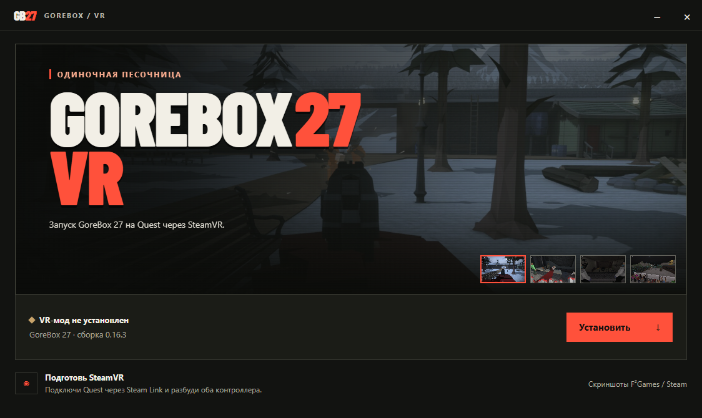

# GOREBOX 27 VR

**Лаунчер для одиночной песочницы GoreBox 27 на Quest**

[Все версии](https://github.com/kydrox123/gorebox27-vr/releases) · [Что изменилось в v1](CHANGELOG.md)

## Установка и запуск

1. [Скачай ZIP лаунчера v1](https://github.com/kydrox123/gorebox27-vr/releases/download/v1/GoreBox-VR-Launcher-v1.zip) и распакуй архив целиком.
2. Открой `GoreBox VR Launcher.exe` и нажми **Установить**.
3. Подключи Quest к ПК через Steam Link, открой SteamVR и разбуди оба контроллера.
4. Нажми **Запустить игру** и зайди в одиночную песочницу.

Кнопка **Удалить** восстанавливает исходный файл игры, который меняет лаунчер.

## Что есть в v1

- Установка и удаление VR-патча из лаунчера.
- Запуск через Steam с проверкой шлема и обоих контроллеров.
- Галерея скриншотов с анимированными переходами.

**Совместимость** — Windows x64, GoreBox в Steam на ветке `gb27`, версия игры **0.16.3**, сборка Steam **26471092**. Для VR нужен SteamVR. Установку и удаление проверили на копии файлов игры. Полный тест запуска из Electron в шлеме ещё впереди.

## Развитие проекта

**v1** — первая версия лаунчера. Доработки выходят постепенно. Заметки и архивы новых сборок будут в [релизах GitHub](https://github.com/kydrox123/gorebox27-vr/releases). Анонсы и обновления мода публикуются в [официальном Telegram-канале GoreBox 27 VR](https://t.me/gorebox27vr).

Исходники и команды сборки доступны в [инструкции по сборке](BUILD.md). Скриншоты игры взяты со [страницы GoreBox в Steam](https://store.steampowered.com/app/2027330/GoreBox/).
